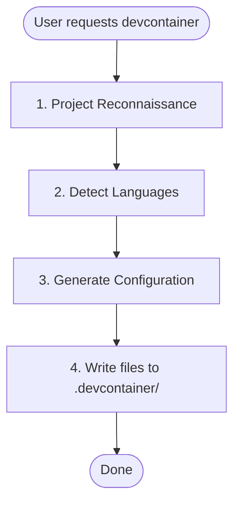

## Bundled upstream support

Supporting files are included at skill-relative paths. See [UPSTREAM-NOTICE.md](UPSTREAM-NOTICE.md) for their pinned sources, licenses, hashes, and import changes.

# Devcontainer Setup Skill

Creates a pre-configured devcontainer with Claude Code and language-specific tooling.

## When to Use
- User asks to "set up a devcontainer" or "add devcontainer support"
- User wants a sandboxed Claude Code development environment
- User needs isolated development environments with persistent configuration

## When NOT to Use

- User already has a devcontainer configuration and just needs modifications
- User is asking about general Docker or container questions
- User wants to deploy production containers (this is for development only)

## Missing template prerequisite

This tracked bundle includes the two references and their CC-BY-SA-4.0 notice/license, but no resources directory, Dockerfile, devcontainer.json, post_install.py, .zshrc or install.sh. The workflow below describes an upstream design, not runnable bundled automation. Stop that template-copy/helper path when files are absent. Draft a minimal reviewed configuration from the project requirements or use a separately reviewed immutable upstream source; do not execute an invented helper or automatically install plugins. Preserve existing configuration and lockfiles.

Devcontainers execute image/feature/lifecycle/build code and mount host files; they are not a strong boundary for hostile repositories by default. Avoid Docker socket, host credentials, privileged mode and NET_ADMIN. Agent-writable firewall rules are not an independent network boundary. Scope persistent volumes per project/user and consider retained credentials. Install/configuration/marketplace changes require authorization. Validate from a disposable trusted checkout before opening an untrusted project.

## Workflow



## Phase 1: Project Reconnaissance

### Infer Project Name

Check in order (use first match):

1. `package.json` → `name` field
2. `pyproject.toml` → `project.name`
3. `Cargo.toml` → `package.name`
4. `go.mod` → module path (last segment after `/`)
5. Directory name as fallback

Convert to slug: lowercase, replace spaces/underscores with hyphens.

### Detect Language Stack

| Language | Detection Files |
|----------|-----------------|
| Python | `pyproject.toml`, `*.py` |
| Node/TypeScript | `package.json`, `tsconfig.json` |
| Rust | `Cargo.toml` |
| Go | `go.mod`, `go.sum` |

### Multi-Language Projects

If multiple languages are detected, configure all of them in the following priority order:

1. **Python** - Primary language, uses Dockerfile for uv + Python installation
2. **Node/TypeScript** - Uses devcontainer feature
3. **Rust** - Uses devcontainer feature
4. **Go** - Uses devcontainer feature

For multi-language `postCreateCommand`, chain all setup commands:
```
uv run /opt/post_install.py && uv sync && npm ci
```

Extensions and settings from all detected languages should be merged into the configuration.

## Phase 2: Generate Configuration

Only if a separately reviewed template source is actually available, substitute:

- `{{PROJECT_NAME}}` → Human-readable name (e.g., "My Project")
- `{{PROJECT_SLUG}}` → Slug for volumes (e.g., "my-project")

Then apply language-specific modifications below.

## Base Template Features

The base template includes:

- **Historical upstream design:** Claude Code and optional marketplace plugins; none are bundled or approved for automatic activation
- **Python 3.13** via uv (fast binary download)
- **Node 22** via fnm (Fast Node Manager)
- **ast-grep** for AST-based code search
- **Historical upstream design:** network tools; do not grant NET_ADMIN by default or call this enforced isolation
- **Modern CLI tools**: ripgrep, fd, fzf, tmux, git-delta

---

## Language-Specific Sections

### Python Projects

**Detection:** `pyproject.toml`, `requirements.txt`, `setup.py`, or `*.py` files

**Dockerfile additions:**

The base Dockerfile already includes Python 3.13 via uv. If a different version is required (detected from `pyproject.toml`), modify the Python installation:

```dockerfile
# Install Python via uv (fast binary download, not source compilation)
RUN uv python install <version> --default
```

**devcontainer.json extensions:**

Add to `customizations.vscode.extensions`:
```json
"ms-python.python",
"ms-python.vscode-pylance",
"charliermarsh.ruff"
```

Add to `customizations.vscode.settings`:
```json
"python.defaultInterpreterPath": ".venv/bin/python",
"[python]": {
  "editor.defaultFormatter": "charliermarsh.ruff",
  "editor.codeActionsOnSave": {
    "source.organizeIm
